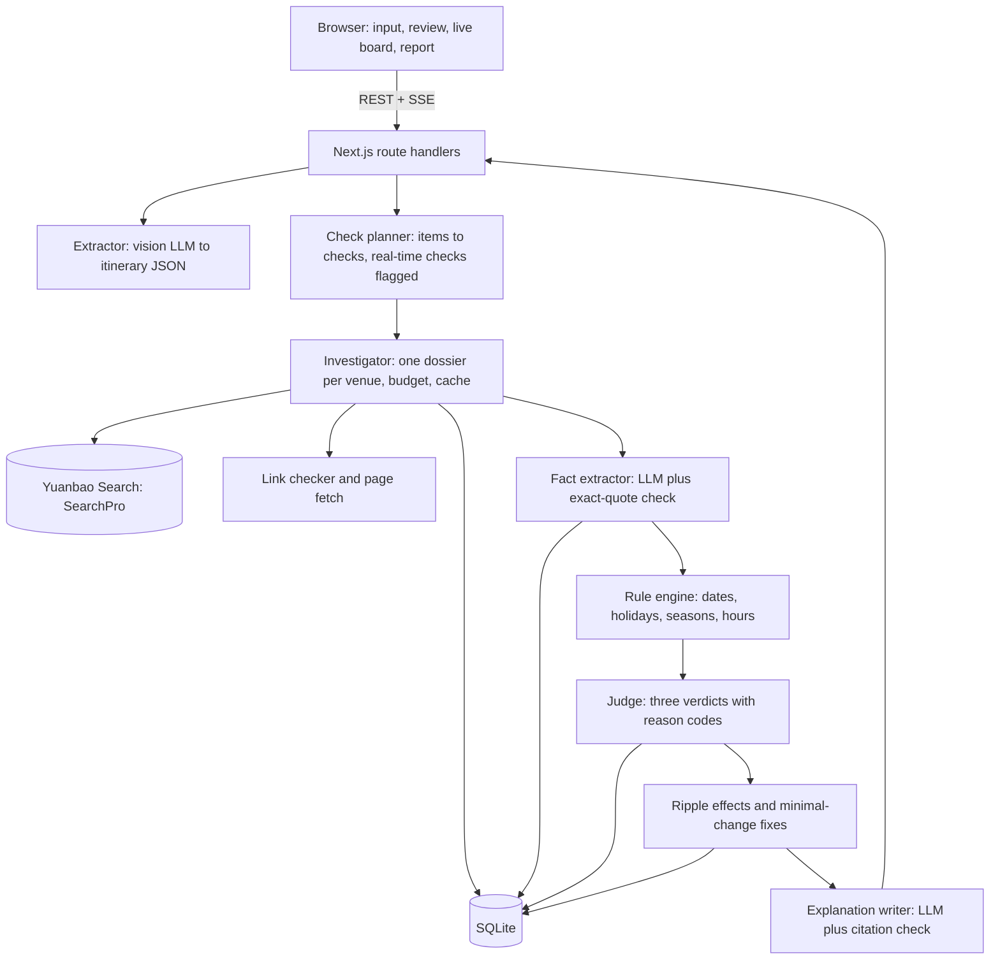

# TripProof《攻略压力测试》: Feasibility Review and Technical Plan

- **Event:** WaytoAGI 1024 切磋大会, Detective track (侦探 · 查得到，信得过)
- **Written:** Fri Oct 23, 2026, about 01:00 Beijing time. **Submission closes:** Sun Oct 25, 16:00. All times are Beijing time.
- **Basis:** your brief (TripProof2.md), the official rules page (v1.0) and Detective track page, Tencent Cloud's Yuanbao Search docs and SDKs, and network checks run on Oct 23. Section 1 lists what was verified.

---

## 0. Bottom line

**Go, with a narrower first version.** TripProof fits the Detective track unusually well. One saved itinerary turns into a dozen small, checkable questions, so a single run demonstrates the track's differentiators: breaking a problem into parts, multi-step search, cross-checking, handling contradictory sources, and saying "unknown" honestly. The concrete moment ("you're about to pay, and the museum is closed that Monday") also scores on scenario value and makes a strong live demo.

It is buildable during the event: about 6.5 h of coding on Oct 24, about 3 h on the morning of Oct 25, and about 3 h in the optional evening session in between. The last 2.5 h before the deadline go to submission, the video and testing. It works under four conditions:

1. **The LLM reads; code judges.** The model turns screenshots into an itinerary and pulls exact quotes out of search results. Every date, weekday, holiday and opening-hours comparison runs in deterministic code. This is what makes "查得准" defensible in front of judges.
2. **The first version covers four checks:** open on that date; opening hours and last entry against your planned time; reservation rules; and a fixed boundary for real-time data (inventory, seats), which is always "尚无法确认". Transport timing, weather, alternative venues and monitoring are add-ons.
3. **Hosting that mainland judges can open.** Not `*.vercel.app`, which timed out in my test. Use a Hong Kong server with your own domain, and test from a mainland phone network.
4. **Claim and smoke-test the search quota in the first hour of the event.** The invite code is only handed out in the Detective group, and which tier and access method it unlocks is unknown until then.

Three risks matter: search coverage (Yuanbao Search does not index WeChat Official Account articles, where many venues post temporary closures), the unknown quota tier, and time. Mitigations are in §2.

---

## 1. What I verified, and what changes from the brief

### 1.1 Event rules (1024.waytoagi.com/rules v1.0 and /tracks/detective)

| Topic | Official wording, summarized | What it means for TripProof |
|---|---|---|
| Partner tool | Track page: "建议使用 元宝搜索 API". | Your "SearchPro" is right: it is the interface name of 元宝搜索 API (see 1.2). List it as "元宝搜索 API (SearchPro)" under tools used. |
| Track top-3 eligibility | Only works that use the partner tool are ranked for the track top 3. City top 3, local favourite and the 1024 grand prize ignore tools (FAQ). | Every verdict must visibly come from SearchPro calls. |
| What judges look for | 查得准、来源点得开、查不到敢说不知道、**玩法有意思**. Differentiators: difficulty (tricky questions, multi-step investigation, cross-checking, contradictory sources) and **real usage (有没有人真在用)**. | Your brief misses "fun" and "real usage". Both get a plan below. |
| Schedule | Oct 24: 10:30 start, 11:00 opening (includes how to claim benefits), **12:30 development starts**, 19:02 timer pauses (an optional online night room runs until 10:30). Oct 25: **12:00 team freeze**, **16:00 submission deadline, then roadshow and voting**, 17:30 national closing. | About 12 official coding hours. |
| Resubmitting | You can edit and resubmit before 16:00; the first submission time is kept for ranking. | Submit a working version around 12:30 on Oct 25, then update it. |
| Path to awards | Oct 25 roadshows pick each city's top 3 (all tracks together). All-remote teams form the online zone, whose roadshow runs online. Oct 26–31: city and online-zone top 3s go to the national round. Nov 1: awards, including track stars. | My reading: the 3-minute roadshow decides whether you reach the national round. Confirm in the group how track stars are chosen. |
| Scoring | Each judge gives 0–10 per dimension: completion and usability 30% (能跑、能播、能直接用), creativity 25%, scenario value 25%, presentation 20% (3 minutes on what you built, why, and what's next). | See §15. |
| Detective submission | The work, plus 3 real queries as recordings or screenshots (can be mixed), each with the answer, a one-line explanation and clickable source links. Advanced work adds a report file or recording, which can include one genuinely triggered alert or a screenshot-verification demo. | The report export and a "query card" are product features (§12), so the materials come out of the app. |
| Files | Videos up to 500 MB (mp4 H.264 advised). Detective screenshots and the cover: jpg/png/webp, up to 10 MB each. | |
| Free searches | 6000 searches during the event. Get the group QR code in 「我的福利」, join the Detective group, get the invite code there and redeem it. Validity per event instructions. | Tier, access method and expiry are unknown until redeemed. |
| LLM credit | Toklens: ¥1000 of compute per registered player, 2000 codes first come first served, valid 3 days after redemption. | Claim the code early; redeem it when development starts. |
| Data retention | Data sent through event API channels may be kept by technical partners; use your own account for sensitive data. | Keep personal data out of searches and model calls (§7). |

### 1.2 Yuanbao Search API (SearchPro)

Sources: Tencent Cloud docs for product 1806 (pages updated Oct 9 and Oct 20, 2026), the official SDKs (`tencentcloud-sdk-python-wsa` 3.1.190 on PyPI, `tencentcloud-sdk-nodejs-wsa` 4.1.329 on npm), and two unauthenticated probe calls.

| Item | Detail |
|---|---|
| Identity | The SDK describes `SearchPro` (service `wsa`, version `2025-05-08`) as "元宝搜索 (Tencent Yuanbao Search)". The product was renamed from "联网搜索API" on 2026-10-09. |
| Access A (recommended) | Service API key: `POST https://api.wsa.cloud.tencent.com/SearchPro`, header `Authorization: Bearer <key>`, JSON body. Up to 3 keys per account or sub-account; each key is shown only once. |
| Access B | Tencent Cloud API 3.0: host `wsa.tencentcloudapi.com`, Action `SearchPro`, Version `2025-05-08`, TC3 signature with SecretId/SecretKey (the SDK signs for you). |
| Request | `Query` (required). `Site`: one domain to search, or `exclude:a.com\|b.com` (up to 5). `Freshness`: `dN` (1–30), `mN` (1–12), `yN` (1–5), one date, or `start,end`. `Mode`: 0 web, 1 authoritative vertical sources, 2 mixed. `Cnt`: 10/20/30/40/50. `Industry`: gov, news, acad, finance. `Deeplinks` (flagship only). **The lite tier does not support `Mode`, `Cnt` or `Industry`.** |
| Response | `Pages` is an array of **JSON strings**. Each holds title, date, url, passage, content (not on lite), site, score (0–1), authority_level (0–5, flagship only), pics (the API-key sample calls it `images`), favicon and deeplinks. Also returned: `Msg` (e.g. "hit black query"), `RequestId`, and `Version` (lite/standard/flagship; the API-key sample omits it). |
| Errors | Errors come back as **HTTP 200** with `Response.Error.Code`. My probe confirmed this for `UnauthorizedOperation`, which also returned a `RequestId`. Documented codes: `UnauthorizedOperation`, `ResourceNotFound` (service not activated), `ResourceUnavailable` (account in arrears), `RequestLimitExceeded`, `InvalidParameter`, `InternalError`. |
| Limits | 20 QPS on lite and standard, 5 on flagship. Average latency 600–800 ms, P99 about 1.2 s. |
| Price after the free quota | ¥14 / ¥20 / ¥26 per 1000 calls for lite / standard / flagship. Flagship is for enterprise accounts only. Failed calls are not billed. |
| Coverage gap | **No WeChat Official Account (公众号) content**, for copyright reasons. |
| Usage proof | Console → 监控信息 shows `request_count` and `request_qps` per tier. The stats lag; the bill is authoritative. |
| Account | Activating the service needs a real-name-verified Tencent Cloud account. |

### 1.3 Network reachability

Tested from my workspace machine on Oct 23. Its network behaves like a mainland connection (GitHub raw downloads were reset).

| Reachable | Not reachable |
|---|---|
| `api.wsa.cloud.tencent.com`, Alibaba DashScope, DeepSeek, Tencent Hunyuan, AMap | `api.openai.com` (timeout), `api.anthropic.com` (HTTP 403), `*.vercel.app` (timeout) |

---

## 2. Feasibility by component

| Component | Buildable in the window? | Main risk | Decision |
|---|---|---|---|
| Screenshot or text → itinerary | Yes: one vision-model call with a JSON schema | Long screenshots get downscaled until the text is unreadable; messy layouts | **P0.** Split tall images into tiles; the user corrects a table |
| SearchPro integration | Yes: one HTTPS POST | Tier and access method unknown until redeemed | **P0.** The adapter supports both methods and drops parameters the tier doesn't support |
| Open on that date? | Yes | Notices posted only on WeChat are invisible | **P0.** An honest "unknown" that lists what was searched; notice-screenshot upload in P1 |
| Hours and last entry vs plan | Yes | Seasonal hours; branches with the same name | **P0.** Seasonal hours in the schema; venue-match check |
| Reservation rules | Mostly | Rules often live in mini-programs | **P0** for the rule. Availability is always "unknown" |
| Contradictory sources | Yes, with a fixed policy | Over-confident merging | **P0.** An ordered, explainable policy (§10.4) |
| Ripple effects | Yes, pure code | None | **P0** (same-day chain) |
| Minimal-change fixes | Yes, for swaps and time shifts | Combinatorics | **P0 v1** (shift, swap, drop), computed from stored facts with no new searches |
| Transport connections | Partly | Travel time needs a map API, which isn't search | **P1:** schedules via search (cable cars, ferries, last bus). **P2:** AMap travel time |
| Weather | Only for near dates | No forecast exists for far dates | **P1.** Search only when the date is within 7 days; otherwise "forecast not published yet" |
| Investigation report | Yes | None | **P0** (web page plus print to PDF) |
| Monitoring and alerts | Yes, but costs about half a day | Needs one genuinely triggered alert before 16:00 on Oct 25 | **P2.** Only if P0 is solid by 12:00 on Oct 25 |

**Time check.** P0 is about 11–13 focused hours for one strong developer with an AI coding assistant. The official window leaves about 9.5 hours of building once the last 2.5 hours on Oct 25 are kept for submission, the video and testing. A solo developer therefore needs the optional evening session (about 3 hours), and nothing from P1 should start before P0 runs end to end on the deployed URL. With 2–3 people, the evening becomes optional and P1 becomes realistic.

**Top risks and mitigations**

1. **Coverage.** WeChat-only notices and small venues without websites. Mark the check "unknown" and list what was searched. In P1, let users upload a screenshot of a notice and verify it. Use well-known venues in the demo.
2. **Quota surprises.** Smoke-test at about 11:30 on Oct 24. The adapter handles both access methods. The query plan works on lite: the two parameters it relies on, `Site` and `Freshness`, are supported on every tier.
3. **Date errors.** The LLM never does date math; the rule engine does (§10).
4. **Invented quotes or links.** A quote must be an exact substring of retrieved text, and a link is checked before it's cited.
5. **Judges can't open the link.** Hong Kong hosting, your own domain, tested from a mainland phone network.
6. **Scope creep.** Cut lines are in §13.

---

## 3. MVP scope

The brief's five core experiences map to P0: 1 → ingestion and review; 2 → venue investigations; 3 → three verdicts with reasons, sources and times; 4 → ripple effects and minimal-change fixes; 5 → investigation log and report.

**P0: must work by 12:00 on Oct 25**
1. Input: paste text or upload 1–6 screenshots. Trip context: Day 1 date, origin city, arrival time on Day 1, departure time on the last day, transit or driving.
2. Extraction and a correction table, with the screenshot beside it.
3. Venue investigations through SearchPro, feeding four checks: open on date, hours fit, reservation rule, real-time boundary.
4. Evidence handling: normalization, source tiers, link check, exact-quote check, and a log of every call with its RequestId.
5. Verdicts in three states (可确认 / 存在冲突 / 尚无法确认), each with a reason code, an explanation, sources, publish dates and retrieval times. Contradictions are shown side by side. The trip gets a headline result, such as "13 checks: 8 可确认, 2 存在冲突, 3 尚无法确认".
6. Ripple effects within the same day.
7. Minimal-change fixes v1 (shift time, swap with another day, drop), each showing the verdicts it would produce.
8. A live investigation board (server-sent events) and a shareable report page that prints to PDF.
9. A usage counter and a 👍/👎 on each verdict.

**P1: only after P0 runs on the deployed URL**
- "Try another date": re-evaluate stored facts for a new date without new searches.
- Notice-screenshot check: upload a screenshot of a WeChat notice; the app extracts the claim and looks for corroboration. This covers the WeChat gap and gives a second screenshot-verification demo.
- Service hours for cable cars, ferries, shuttles and last buses.
- Weather for dates within 7 days.
- A freshness badge comparing the guide's own date with the current rules.

**P2: only if time is left**
- Monitoring (持续盯梢): re-run volatile checks every 30–60 minutes with `Freshness=d1`, push alerts to a Feishu bot webhook or email, and keep an alert log.
- AMap travel-time estimates between consecutive stops.
- Alternative venues.

**Out of scope:** booking, payment, accounts, overseas trips (at most a "beta" label), native apps.

---

## 4. Tech stack and deployment

| Layer | Choice | Why |
|---|---|---|
| App | Next.js (App Router) + TypeScript; UI and API routes in one repo | One deploy; keys stay on the server |
| UI | Tailwind + shadcn/ui, mobile first | Fast to build; judges and users open it on phones |
| Live updates | Server-sent events from a route handler | A simple one-way stream that works through Caddy |
| Storage | SQLite (better-sqlite3) + Drizzle | One file on one server, nothing else to run |
| Validation | zod on every model output | Rejects malformed or invented fields |
| Models | An OpenAI-compatible client configured per role: vision extraction, fact extraction, writing | Providers can be swapped without code changes. Use domestic endpoints (e.g. Qwen-VL via Alibaba Bailian, DeepSeek, Hunyuan) or a gateway such as Toklens. OpenAI and Anthropic APIs weren't directly reachable in my test |
| Search | Yuanbao Search through the API-key method with `fetch`; the AK/SK method via `tencentcloud-sdk-nodejs-wsa` as a fallback adapter | Use whichever the invite code activates |
| Page checks | `fetch` with timeouts, plus cheerio for text extraction | Enough for link checks and quote verification |
| Dates | dayjs in the Asia/Shanghai time zone; a holiday table in JSON | Deterministic date math |
| Hosting | Hong Kong VPS (e.g. Tencent Cloud Lighthouse HK) + Docker + Caddy (automatic HTTPS) + a non-.cn domain | Mainland servers need ICP filing, which takes weeks. Hong Kong doesn't need it and is reachable from the mainland |
| Scheduler (P2) | System cron calling `POST /api/cron/watch` | No extra worker process |

---

## 5. Architecture



**Design principles**
1. **The LLM reads, code judges.** Models extract; the rule engine decides.
2. **Every sentence points to evidence, and every piece of evidence points to a SearchPro RequestId.**
3. **Not finding something proves nothing.** "No closure notice found" is shown as a caveat. It never confirms a plan on its own.
4. **Investigate each venue once.** A venue's facts serve every check on it, every fix and every "try another date".

**Modules**

| Module | Job |
|---|---|
| `extract` | Image tiling, vision call, schema validation, PII scrub |
| `plan` | Item kind → checks; marks real-time checks |
| `investigate` | Venue dossiers, query templates, budget, cache, retries |
| `search/yuanbao` | Adapter for both access methods, tier detection, call log |
| `evidence` | Normalization, source tiers, official-domain detection, link check, snapshots |
| `facts` | LLM fact extraction, exact-quote check, venue-match check |
| `rules` | Holiday calendar, seasons, weekly rules, time windows |
| `judge` | Verdict per check, contradiction policy, reason codes |
| `impact` | Ripple effects and the fix search |
| `report` | Live board data, share page, print layout, query cards |

---

## 6. Data model

```ts
Trip       { id, shareId, startDate, originCity, arriveDay1?: 'HH:mm', leaveLastDay?: 'HH:mm',
             mode: 'transit' | 'drive', guidePublishedAt?, createdAt }
Item       { id, tripId, day, date, seq, start?: 'HH:mm', end?: 'HH:mm', placeName, city,
             kind: 'museum' | 'scenic' | 'show' | 'restaurant' | 'transport' | 'hotel' | 'other',
             activity, sourceText, confidence, dependsOn?: string[] }
Venue      { id, canonicalName, city, officialDomain?, officialDomainEvidenceId? }
Check      { id, itemId, venueId, type, date, realtime: boolean, status }
SearchCall { id, venueId, query, params, requestId, version?, msg?, errorCode?,
             resultCount, latencyMs, calledAt, cacheHit }
Evidence   { id, searchCallId, url, finalUrl?, title, site, publishedAt?, retrievedAt,
             passage, content?, score, authorityLevel?, tier: 1 | 2 | 3 | 4,
             linkStatus: 'ok' | 'browser_only' | 'broken', linkCheckedAt, pageSha256? }
Fact       { id, venueId, kind, payload, evidenceId, quote, quoteVerified: boolean,
             venueMatch: 'exact' | 'other_branch' | 'unclear', publishedAt? }
Judgment   { id, checkId, verdict: 'confirmed' | 'conflict' | 'unknown', severity?: 'hard' | 'soft',
             reasonCode, explanation, factIds, overruledFactIds, searchedScope, judgedAt }
Ripple     { itemId, causeItemId, reason }
Suggestion { id, tripId, ops, cost, verdictsAfter }
Feedback   { judgmentId, vote: 1 | -1, sessionId, at }
Watch, Alert (P2) { tripId, channel, target, lastHash, alertedAt, payload }
```

Venue dossiers are keyed by canonical name and city, so trips can share them for 6 hours.

---

## 7. Ingestion: screenshot or text to itinerary (截图查证)

1. **In the browser:** accept up to 6 images. Re-encode them through a canvas, which also drops EXIF data. Split any image taller than 1.6 times its width into tiles with about 10% overlap, so small text in long screenshots stays readable.
2. **On the server:** one vision call with all tiles in order and a strict JSON schema, at temperature 0. Validate with zod; on invalid JSON, retry once with the error message.
3. **Traceability:** every item must carry `source_text` copied from the image. Items without it are dropped. Fields with confidence below 0.7 are highlighted for review.
4. **Privacy:** the prompt forbids outputting names, phone numbers, ID numbers and booking or order numbers, and a regex pass removes any that slip through. Images are deleted after extraction. Search queries only ever contain venue names, cities and dates.
5. **Review screen:** the screenshot on the left, an editable table on the right. The user maps Day 1 to a date and enters the Day 1 arrival and last-day departure times. **Nothing is searched until the user confirms.** That saves quota and keeps the user responsible for the input.
6. Pasted text uses the same schema with a text-only call.

```json
{
  "guide_meta": { "title": "string|null", "published_at": "YYYY-MM-DD|null" },
  "days": [{
    "day_index": 1,
    "items": [{
      "seq": 1, "start_time": "HH:mm|null", "end_time": "HH:mm|null",
      "place_name": "as written", "city": "string|null",
      "kind": "museum|scenic|show|restaurant|transport|hotel|other",
      "activity": "string", "transport_to_next": "string|null",
      "depends_on_previous": "string|null",
      "source_text": "verbatim text from the image", "confidence": 0.0
    }]
  }],
  "ambiguities": ["string"]
}
```

---

## 8. Check planning

The planner is deterministic and driven by item kind. The LLM only normalizes names (an abbreviation to the full official name, plus the city).

| Check | Applies to | Searchable? | Facts needed | When nothing usable is found |
|---|---|---|---|---|
| `open_on_date` | Museums, scenic areas, venues | Yes | weekly_closure, temp_closure, temp_open | Unknown: `NO_EVIDENCE` |
| `hours_fit` | Any item with a planned time | Yes | hours (seasonal), temp_hours | Unknown: `NO_EVIDENCE` |
| `reservation_rule` | Museums, popular sites, shows | Yes, the rule | reservation | Unknown: `NO_EVIDENCE` |
| `availability` | Tickets, reservation slots, train seats | **No: real-time** | None | Always unknown: `REALTIME`, with where to check |
| `arrival_fit` | Day 1 items before arrival; last-day items after departure | No search | The user's times | Conflict or confirmed |
| `service_hours` (P1) | Cable cars, ferries, shuttles, last bus or metro | Yes | service_hours, temporary suspensions | Unknown |
| `weather` (P1) | Outdoor items | Only within 7 days | weather | Unknown: `FORECAST_NOT_YET` |

**Information boundary: always shown as 尚无法确认, with where to check**

| Information | Why it can't be known | Where to check |
|---|---|---|
| Ticket or reservation inventory | Real-time | The venue's official app or mini-program |
| Train and flight seats, live delays | Real-time | 12306, the airline |
| Live traffic and queues | Real-time | Map apps on the day |
| Forecast for a date more than about 7 days away | Not published yet | Check again 3 days before |
| Notices posted only on WeChat or in mini-programs | Not indexed by Yuanbao Search | Upload a screenshot of the notice (P1) |
| Holiday-dependent rules for dates whose holiday schedule isn't out | Not published yet | Check after the State Council notice |

---

## 9. Retrieval and evidence handling

### 9.1 Venue dossier playbook

Query templates stay in Chinese because that is what gets searched.

| Step | Query template | Parameters | Purpose | Run when |
|---|---|---|---|---|
| S1 | `{城市}{场馆} 开放时间 闭馆` | No `Freshness`: official visitor pages are often old but still current, and recency is handled by the contradiction policy | Regular rules; find the official domain | Always |
| S2 | `{场馆} 闭馆 公告` | `Site={official domain}`, `Freshness=m3` | Temporary notices on the official site | An official domain was found |
| S3 | `{场馆} 临时闭馆 {YYYY年M月}` | `Freshness=m2`; `Industry=news` if the tier supports it | News of closures or changes in the trip month | Always |
| S4 | `{场馆} 预约 提前 放票` | No `Freshness`; `Site` when known | Reservation rule | The item kind usually needs booking, or S1 mentions 预约 |
| S5 | A targeted query for the disputed point | As needed | Settle a contradiction or a weak result | Only when needed, at most once |

Stop as soon as there is an official or authoritative rule plus a notice scan (S2 or S3). Caps: 5 calls per venue, 40 per trip, 4 in flight at once.

### 9.2 Budget, cache and retries

- Cache results by (query, parameters) for 6 hours. Monitoring bypasses the cache.
- On `RequestLimitExceeded`, retry after 250 ms and then after 1 s. On `InvalidParameter` with a lite account, drop `Mode`, `Cnt` and `Industry` and retry once.
- Treat a non-empty `Msg` such as "hit black query" as an empty result and record the reason.
- Detect the tier from `Version`. If it's missing (the API-key sample omits it), infer lite when `content` never comes back.
- Rate-limit each browser session (e.g. 10 trips a day) and set a global daily cap, so a public link can't drain the quota.

**6000-search plan**

| Use | Searches |
|---|---:|
| Development and debugging | 1500 |
| Gold-set evaluation, 3 runs | 300 |
| Real users: about 120 trips at a median of 25 | 3000 |
| Roadshow reserve (audience trying their own guides) | 500 |
| Monitoring (P2) | 300 |
| Buffer | 400 |

### 9.3 Normalizing results

```ts
function normalizePage(raw: string): Page {
  const p = JSON.parse(raw);                         // each element of Pages is a JSON string
  return {
    title: stripTags(p.title ?? ''),
    url: p.url,
    site: p.site || new URL(p.url).hostname,
    publishedAt: parseCnDate(p.date),                // "2025/02/26 09:37:00" or "2024-06-07 19:00:51", Asia/Shanghai
    passage: stripTags(p.passage ?? ''),             // passages can contain <strong> highlights
    content: p.content ? stripTags(p.content) : undefined,   // missing on lite
    score: p.score,
    authorityLevel: p.authority_level,               // flagship only
    images: p.pics ?? p.images ?? [],                // both names appear in the docs
  };
}
```

### 9.4 Source tiers and the official domain

| Tier | What counts | Weight |
|---|---|---|
| T1 official | The venue's official domain; `*.gov.cn`; official ticketing such as 12306 | Can confirm on its own |
| T2 authoritative | Mainstream and official local media; Mode 1 "authoritative vertical" results; `authority_level` ≥ 4 | Can confirm on its own |
| T3 platform | Travel booking sites, map listings, review sites | Needs 2 independent agreeing sources |
| T4 user-generated | Self-media platforms, Q&A sites, blogs. **The guide itself is T4** | Never confirms; can only cause "unknown" or a re-check |

**Official-domain detection:** among S1 results, pick one whose title or `site` contains the venue name together with "官网" or "官方", or whose domain ends in `.gov.cn` or `.org.cn`. Known booking, review and self-media domains are excluded. The chosen domain is stored with its evidence, so "this is the official site" is itself a sourced claim.

**Independence:** results from the same domain count once, and syndicated copies with the same title count once.

### 9.5 Link check (来源点得开)

- Before a URL is cited: GET with a 6 s timeout, up to 3 redirects, and an honest bot User-Agent with a contact address.
- 2xx or 3xx is `ok`. 403 or 429 is `browser_only`: the site blocks bots, but the link usually opens in a browser. 404, 410, 5xx, DNS errors and "page not found" titles are `broken`, and a broken link is never the primary citation.
- The UI shows "✓ 链接已验证 10-24 15:02". Links are checked again when a report is exported.

### 9.6 Fact extraction with an exact-quote check

- The model receives the check question, the venue's canonical name and city, the trip date (for context only), and the evidence items (id, site, publish date, text). It returns facts in the schema from §10.1, each with an `evidenceId`, a `quote` of at most 80 characters, and a `venueMatch`.
- **Code then checks** that the quote is an exact substring of that evidence's text, after normalizing whitespace and punctuation. If it isn't, the fact is discarded. Facts whose `venueMatch` isn't `exact` are discarded too, because same-name branches are a classic travel-guide trap.
- For T1 sources, the page is fetched once (text extracted with cheerio, limited to about 8,000 characters around the venue name), because snippets often cut off notice dates. A hash of that text is stored as a lightweight snapshot.

### 9.7 Provenance, and how it proves SearchPro use

- Every SearchPro call is stored with its query, parameters, time, latency, result count and RequestId, and streamed to the live board as it happens.
- Every verdict links to its facts, every fact to its evidence, and every piece of evidence to its call. The report ends with an appendix listing all calls.
- For the submission: a screen recording of the board showing calls and RequestIds live, the report appendix, and a screenshot of the console's 监控信息 page showing the call count.

---

## 10. Core judgment logic

### 10.1 Fact types

```ts
type Fact = {
  evidenceId: string; quote: string; venueMatch: 'exact' | 'other_branch' | 'unclear';
  publishedAt?: string;
} & (
  | { kind: 'weekly_closure'; closedWeekdays: number[]; exceptStatutoryHolidays: boolean; note?: string }
  | { kind: 'hours'; seasons: { from: 'MM-DD'; to: 'MM-DD'; open: 'HH:mm'; close: 'HH:mm'; lastEntry?: 'HH:mm' }[] }
  | { kind: 'temp_closure'; from: 'YYYY-MM-DD'; to: 'YYYY-MM-DD'; scope: 'whole' | 'partial'; note: string }
  | { kind: 'temp_open'; from: 'YYYY-MM-DD'; to: 'YYYY-MM-DD'; note: string }   // e.g. "open as usual on that Monday"
  | { kind: 'temp_hours'; from: 'YYYY-MM-DD'; to: 'YYYY-MM-DD'; open: 'HH:mm'; close: 'HH:mm'; lastEntry?: 'HH:mm' }
  | { kind: 'reservation'; required: boolean; advanceDays?: number; releaseTime?: 'HH:mm'; channel?: string; realName?: boolean }
  | { kind: 'service_hours'; entity: string; seasons: { from: 'MM-DD'; to: 'MM-DD'; first?: 'HH:mm'; last: 'HH:mm' }[] }
  | { kind: 'weather'; date: 'YYYY-MM-DD'; summary: string; precipitationProb?: number; warning?: string }
);
```

The model only fills these fields from quoted text. It never computes anything.

### 10.2 The date engine

- Weekday and date math in Asia/Shanghai.
- A table of statutory holidays and make-up working days, loaded from the State Council notice. After the National Day holiday, the next statutory holiday is New Year's Day 2027. For dates in 2027, if the 2027 schedule isn't published yet, holiday-dependent rules return "unknown" with reason `HOLIDAY_SCHEDULE_NOT_PUBLISHED`. Optionally, check at run time with `Industry=gov`, since the notice could come out any week now.
- Season selection for `MM-DD` ranges, including ranges that wrap around the new year.
- Seasonal changeovers matter right now, because guides written in summer often list summer hours. Whether a particular venue switches in November is something to verify with real queries, not assume.

### 10.3 Verdict rules

```ts
function judge(check: Check, facts: Fact[], ctx: TripContext): Judgment {
  if (check.realtime) return unknown('REALTIME', { whereToCheck: check.officialChannel });

  const usable = facts.filter(f => f.quoteVerified && f.venueMatch === 'exact' && relevant(f, check));
  if (usable.length === 0) return unknown('NO_EVIDENCE', { searched: check.searchedScope });

  // 1. A notice that names the trip date beats a general rule.
  const specific = usable.filter(f => isTemporary(f) && covers(f, check.date));
  const pool = specific.length > 0 ? specific : usable.filter(f => !isTemporary(f));

  // 2. Pick the winner, or admit that the sources disagree (10.4).
  const pick = resolve(pool);
  if (pick.status === 'disagree') return unknown('SOURCES_DISAGREE', { sides: pick.sides });
  if (pick.strength === 'weak') return unknown('WEAK_EVIDENCE', { bestGuess: pick.fact });

  // 3. Pure date and time math against the plan. No LLM here.
  const r = evaluate(pick.fact, check, ctx);
  if (r.hard) return conflict(r.reasonCode, pick);          // closed that day, arriving after last entry
  return confirmed(pick, {
    notes: r.soft,                                           // e.g. "only 40 minutes before closing"
    caveat: specific.length === 0 ? noNoticeCaveat(check) : undefined,
  });
}
```

| Situation | Verdict | Reason code |
|---|---|---|
| A weekly closure applies to the date and isn't lifted by a holiday rule or a `temp_open` | 存在冲突 (hard) | `CLOSED_WEEKLY` |
| A `temp_closure` covers the date | 存在冲突 (hard) | `TEMP_CLOSED` |
| Planned arrival is after last entry, or the visit starts after closing | 存在冲突 (hard) | `AFTER_LAST_ENTRY` / `OUTSIDE_HOURS` |
| Less than 60 minutes between arrival and closing | 可确认 with a warning (soft) | `SHORT_VISIT` |
| Reservation required | 可确认 with an action such as "booking opens {date} {time}", computed from `advanceDays` and `releaseTime` | `RESERVATION_REQUIRED` |
| A Day 1 item before your arrival, or a last-day item after you leave | 存在冲突 (hard) | `BEFORE_ARRIVAL` / `AFTER_DEPARTURE` |
| The regular rule says open and no notice was found | 可确认, with the caveat "no temporary notice found (searched: official site, last 3 months; news, last 2 months)" | `OPEN_BY_RULE` |

### 10.4 Contradiction policy

Applied in order. Every step taken is shown to the user.

1. A dated notice that covers the trip date beats a general rule.
2. A higher tier beats a lower tier.
3. Within the same tier, the newer dated source beats the older one. An undated source never overrides a dated one.
4. Agreement across more independent domains beats agreement across fewer.
5. If the top two still contradict each other, are in the same tier, and can't be ordered by date, the verdict is **尚无法确认** (`SOURCES_DISAGREE`). Both quotes are shown with their dates and links, plus who to ask.
6. Strength: "strong" needs one T1/T2 source, or two independent T3 sources with no contradiction. Anything less is `WEAK_EVIDENCE`, and the best guess is shown as reference only.

The UI also shows the overruled side. For example: "The guide (written 2024-05) says 9:00–17:30; the official site (published last week) says 9:00–16:30 from Nov 1. We use the official site because it is official and newer."

### 10.5 Ripple effects (连锁影响)

```ts
for (const i of conflictedItems) {
  const next = nextOnSameDay(i);
  if (next) mark(next, 'LEG_ORIGIN_CHANGED');                       // the trip to the next stop changes
  for (const j of sameDayAfter(i))
    if (gapMinutes(prevOf(j), j) < 30) mark(j, 'TIMING_CHAIN');     // tightly chained times
  for (const j of itemsAtSameVenue(i)) mark(j, 'SAME_VENUE');      // e.g. lunch inside the museum
  for (const j of explicitDependents(i)) mark(j, 'EXPLICIT');      // from depends_on_previous
}
```

Affected items show "需重新确认" with a one-line reason, for example: "Lunch in the museum café and the 13:30 walk from the museum to X depend on the museum visit."

### 10.6 Minimal-change fixes

```ts
function suggest(trip, facts): Suggestion[] {
  const out = [];
  for (const i of conflictedItems(trip)) {
    for (const slot of freeSlotsSameDay(trip, i)) consider(shift(i, slot));   // e.g. arrive before last entry
    for (const j of itemsOnOtherDays(trip, i)) consider(swap(i, j));         // swap with another day
    out.push(drop(i));                                                       // last resort; lists affected items
  }
  function consider(plan) {
    const after = reevaluate(plan, facts);          // stored facts only, no new searches
    if (after.conflicts === 0) out.push({ plan, cost: cost(plan), unknowns: after.unknowns });
  }
  return sortBy(out, ['cost', 'unknowns']).slice(0, 3);
}
// cost = items moved + days changed + hours shifted / 4; swaps within the same half-day are preferred
```

Each fix shows a before/after timeline and its own verdicts. A fix that introduces an unknown says so.

### 10.7 Explanation writer

- Input: the computed verdict, the facts it used, and the plan item. Output: 1–2 sentences in Chinese that cite facts as `[E#]`.
- Checks: the text is rejected if it cites an id that doesn't exist, or contains a date, time or number that isn't in the inputs. On rejection, a template sentence built from the reason code is used instead.

---

## 11. API and stream contract

| Endpoint | Purpose |
|---|---|
| `POST /api/extract` | Images or text → itinerary JSON. Images aren't stored |
| `POST /api/trips` | Context and confirmed itinerary → `tripId` |
| `POST /api/trips/:id/runs`, then `GET /api/runs/:id/events` | Start an investigation, then subscribe to its event stream |
| `GET /api/trips/:id` | Full state: items, checks, verdicts, evidence, fixes |
| `POST /api/trips/:id/whatif` | A new date or a move → recomputed verdicts, no searches (P1) |
| `POST /api/feedback` | 👍/👎 on a verdict |
| `GET /r/:shareId` | Public read-only report |
| `POST /api/trips/:id/watch`, `POST /api/cron/watch` | Monitoring (P2). The cron route needs a secret header |

Stream events: `plan`, `search` (query, parameters, RequestId, latency, result count), `evidence` (title, site, publish date, tier, link status), `fact`, `verdict`, `ripple`, `suggestion`, `budget` (used/limit), `done`, `error`.

---

## 12. Advanced capabilities and the evidence you hand in

| Track capability | What TripProof does | What you submit |
|---|---|---|
| 截图查证 (screenshot verification) | The core input: a guide screenshot becomes claims, and each is checked with sources. P1 adds checking a screenshot of an official notice | A recording: upload → board → a verdict with its source opened |
| 深度调查 (deep investigation) | Multi-step dossiers per venue, cross-checking, the contradiction policy, ripple effects | The exported report (PDF): verdicts, sources, retrieval times, contradictions and how they were resolved, and the call log |
| 持续盯梢 (monitoring), optional | Re-runs volatile checks and pushes an alert when a verdict changes | One genuinely triggered alert screenshot, plus the alert log |

For monitoring to produce a real alert before 16:00 on Oct 25, watch something that genuinely changes, such as a near-term weather forecast. Never stage an alert.

---

## 13. Build order (Beijing time)

### Before the event: today, Oct 23 (no product code)

- [ ] On 1024.waytoagi.com: register, choose the Detective track, open 「我的福利」 and join the Detective group. The invite code is only handed out there.
- [ ] Tencent Cloud: create an account and complete individual real-name verification, which activating Yuanbao Search requires.
- [ ] Have a fallback vision-model key from a domestic provider, in case the Toklens models don't fit.
- [ ] Rent a Hong Kong VPS, register a non-.cn domain, point its DNS at the server, and install Docker and Caddy.
- [ ] Collect 5–8 real guide screenshots (your own, or used with permission) and 2–3 real upcoming trips from friends.
- [ ] Build the gold set by hand: 10–15 checks with ground truth from official sources, each with its URL and the time you checked.
- [ ] Draft the pitch storyline.
- [ ] Ask the organizers whether scaffolding code written before 12:30 on Oct 24 is acceptable if disclosed. If in doubt, write no app code before then.

### Oct 24

| Time | Milestone | Done when |
|---|---|---|
| 11:00–12:30 | Opening. Claim the Toklens code and the search invite code; redeem the search code and smoke-test SearchPro (Appendix A); check in a model playground that the vision model reads 2 real screenshots. Redeem Toklens at 12:30 | A real SearchPro response with a RequestId; tier noted |
| 12:30–13:30 | **M0 Skeleton:** Next.js app, SQLite schema, search adapter with call log, model adapter, deployed to the server | The deployed URL shows a live SearchPro result with its RequestId |
| 13:30–15:00 | **M1 Ingestion:** paste or upload → tiles → extraction → review table → confirm | Each of 3 real screenshots can be corrected in under a minute |
| 15:00–17:30 | **M2 Investigate and judge v1:** planner, dossier S1–S4, normalization, tiers, fact extraction with the quote check, link check, rule engine, three verdicts with a basic resolve (tier, then date) | One real trip gets verdicts with checked source links |
| 17:30–19:00 | **M3 Live board:** event stream, evidence cards, link badges, budget meter | A full run can be watched on the deployed URL |
| 19:02 | **Checkpoint A:** end to end on the deployed URL. If it isn't, the evening goes to fixing, not features | |
| Evening session (≤ 3 h, then sleep) | **M4:** the full contradiction policy and contradiction card, ripple effects, fixes v1; run the gold set and tune prompts | Gold set: zero false confirmations |

### Oct 25

| Time | Milestone | Done when |
|---|---|---|
| 10:30–12:00 | **M5:** report page, share link, print to PDF, boundary panel, query cards, feedback buttons, usage counter, phone layout pass. Settle any team changes before the 12:00 freeze | The report opens and prints on a phone |
| 12:00–12:30 | **First submission** with every required field (it can be updated later) | Submitted |
| 12:30–13:30 | Real-usage push; create the 3 real query cards; start P1/P2 only if P0 is solid | At least 10 real trips checked |
| 13:30–14:30 | Record the 3-minute demo (also the roadshow backup), screenshots, cover image, report export | Files ready |
| 14:30–15:30 | Final checks from a mainland phone network; disclosure text; resubmit | Final submission |
| 15:30 | Code freeze. Roadshow from 16:00 | |

**If you skip the evening session:** M4 moves to 10:30–12:00 on Oct 25, you still submit at 12:00 with what works, M5 moves to 12:30–13:30, the real-usage push gets whatever time is left, and P1/P2 are off the table.

**Cut lines, in order:** monitoring → weather → service hours → "try another date" → fixes reduced to shift and drop. **Never cut:** the link check, the quote check, the unknown state, the RequestId log.

**With teammates:** A owns the investigator and rule engine; B the frontend (input, board, report); C the gold set, prompts, real queries and pitch; D deployment, monitoring and finding real users.

---

## 14. Acceptance and evaluation

### 14.1 Gold set

Build 10–15 checks over 6–8 real venues before the event, with ground truth taken by hand from official sources (URL and time recorded). Cover:
- a weekly closure on the planned date, plus a holiday-exception case if one falls in range
- seasonal hours with a late planned arrival
- a temporary closure or change, if a real one exists in the window
- a reservation rule
- a real-time question, which must come out unknown
- a venue whose sources disagree
- a same-name or branch ambiguity

### 14.2 Targets

| Metric | Target |
|---|---|
| False confirmations (green when the truth is a conflict) | **0**. This is a hard gate |
| Verdict accuracy on the gold set | ≥ 80% |
| Unknown rate on searchable checks | ≤ 30%; above that, the product isn't useful |
| Cited links verified at citation time | 100% |
| Quotes found verbatim in the evidence | 100% |
| Extraction: place names and times right before edits, on 5 real screenshots | ≥ 90% |
| Speed: first verdict / full 6-stop trip | ≤ 20 s / ≤ 90 s |
| Searches per trip | ≤ 40, median ≤ 25 |

Run the gold set as a script (`scripts/goldset.ts`) after every prompt or policy change.

### 14.3 P0 acceptance checklist

All on the deployed URL, from a mainland phone network:

1. Pasted text → review → run → verdicts in under 90 s for a 6-stop trip.
2. A real long screenshot is extracted into editable fields.
3. Each verdict shows its state, its reason, at least one source (title, site, publish date, retrieval time), the quote highlighted, and a link badge.
4. Every cited link opens.
5. A real-time question shows 尚无法确认 and where to check.
6. A contradiction shows both sides and why one wins, or why it stays unknown.
7. A conflict shows its ripple effects and at least one fix with its own verdicts.
8. The log lists every SearchPro call with its query, parameters, time and RequestId.
9. The report has a share link and prints to PDF.
10. The usage counter goes up and feedback votes are recorded.

---

## 15. Winning on the scoring criteria

| Criterion (weight) | What judges want | How TripProof shows it | Proof |
|---|---|---|---|
| Completion and usability (30%) | It runs and is usable right away | No login; one-click sample trips; works on phones; reachable from the mainland; clear unknowns instead of errors | The link; the demo video; 3 real query cards |
| Creativity (25%) | A new idea that's fun to use | A "stress test" for travel guides with a headline result for the trip; a live detective board; red, green and grey verdict stamps; try another date; one-tap minimal fixes | Demo moments |
| Scenario value (25%) | A real problem people want solved | The moment before paying or leaving; families and first-time visitors; real users over the weekend; sharing the report with travel companions | Usage counter, feedback votes, 1–2 user quotes |
| Presentation (20%) | 3 minutes: what, why, what's next | A live run with a real conflict; the trust mechanics; real numbers; next steps | Pitch plus backup video |

Detective-specific mapping: 查得准 → zero false confirmations on the gold set; 来源点得开 → link badges and retrieval times; 查不到敢说不知道 → the boundary panel and grey stamps; multi-step investigation, cross-checking and contradictions → the dossier log and the contradiction card; real usage → the counter and feedback.

### 15.1 Three-minute pitch

| Time | Content |
|---|---|
| 0:00–0:20 | Hook: a real saved guide. "If you leave tomorrow with this guide, where does it break?" |
| 0:20–1:50 | Live: upload → review (5 s) → the board streams SearchPro calls with RequestIds → a red stamp on a real conflict → open the official source → ripple effects and a one-tap fix → a grey stamp on a real-time item: "We can't find this, and we won't pretend we did." |
| 1:50–2:30 | Why trust it: the LLM reads and code judges; exact quotes and checked links; gold-set results; real usage numbers |
| 2:30–3:00 | What's next: watching the trip until departure, checking WeChat notice screenshots, a "check before you book" step for travel platforms |

End on a QR code so the audience (or the online meeting chat) can stress-test their own saved guides. That brings real usage into the room and helps with the popularity vote.

### 15.2 The three real queries

Pick three that show different abilities, all with real venues, real dates and real results:
1. **A conflict that needs two or more steps:** a regular rule plus an exception or a notice.
2. **A contradiction resolved by tier or date:** for example, a guide's hours against the official site's current hours.
3. **An honest unknown:** something real-time or unpublished, with the scope searched and where to check.

The app's query card produces the required format:

```
问题：按这份攻略，{日期}（{星期}）{时间} 去「{场馆}」行得通吗？
答案：{可确认 / 存在冲突 / 尚无法确认}：{一句话结论}
一句话解释：{为什么，引用了哪条规则或公告}
来源：[{标题}]({url})（发布 {日期}，检索 {时间}）；[{标题}]({url})
检索记录：SearchPro ×{n}，RequestId {…}
```

### 15.3 Real usage

- On the evening of Oct 24, send the link to friends with trips coming up, and to community groups: "把你收藏的攻略丢进来压测一下".
- Show only real numbers in the pitch: trips checked, issues found, share of 👍.
- Keep usage anonymous: a random session id, no personal data.

### 15.4 Where it could lose

- **"Why not just ask a chatbot?"** Answer in one line: a chatbot doesn't bind each answer to your date and time, doesn't check its links or quotes, doesn't trace effects through your day, and rarely says "unknown" with the scope it searched.
- **A single false "可确认" seen by a judge** costs more than ten unknowns. Keep the policy conservative.
- **A link that doesn't open** during judging. That's why links are checked, the app is hosted in Hong Kong, and there's a backup video.

### 15.5 Submission checklist

- 作品名称: TripProof《攻略压力测试》
- 一句话介绍 (suggestion): 按你的出行日期，给收藏的旅行攻略做一次有出处的压力测试：哪里走不通、证据在哪、怎么少改动。
- Link: your own domain (tested from a mainland phone network)
- Track: 侦探. Tools used: 元宝搜索 API (SearchPro), the models you used, Next.js and the main libraries
- Demo recording (the field is optional; submit one anyway), the 3 query cards as screenshots (each up to 10 MB), the investigation report and screenshot-verification recording for the advanced part, and a cover image
- No judge test account needed: there's no login
- Disclosure of third-party components and any pre-event preparation

---

## 16. Compliance and disclosure

- Disclose frameworks, libraries, models, the search API, any template, and any preparation done before the event, as the rules require.
- Screenshots are deleted after extraction, personal data is scrubbed, and searches only carry venue names, cities and dates.
- Public report pages show the extracted itinerary and short quotes (at most 80 characters) with links, not the original guide screenshots, which belong to their authors.
- Be polite to websites: one cached GET per cited URL, no pages behind logins, and a bot User-Agent with contact details.
- Content stays within the rules' red lines: no infringement, privacy violations or unsafe content.

---

## 17. Questions to settle in the Detective group (first hour)

1. What does the invite code unlock: a resource pack on your Tencent Cloud account, or an API key? Which tier (lite or standard)? Until when?
2. Is there a required way to prove use of the tool (console screenshots, RequestIds, or both)?
3. Are track stars chosen from all Detective entries, or only from works that reach the national round?
4. Is preparation code written before 12:30 on Oct 24 acceptable if disclosed?

---

## Appendix A. SearchPro smoke test and adapter

```bash
export WSA_API_KEY=sk-...        # from the Yuanbao Search console (API-key method)
curl -sS https://api.wsa.cloud.tencent.com/SearchPro \
  -H "Authorization: Bearer $WSA_API_KEY" \
  -H 'Content-Type: application/json; charset=utf-8' \
  -d '{"Query":"故宫博物院 开放时间"}' | python3 -m json.tool | head -40
# Expect Response.Pages and Response.RequestId, and no Response.Error.
# Then add "Cnt":20 and "Industry":"gov". If that causes InvalidParameter, or results never
# include "content", you are on lite.
```

```ts
// lib/search/yuanbao.ts
const ENDPOINT = 'https://api.wsa.cloud.tencent.com/SearchPro';

export async function searchPro(p: SearchParams, tier: Tier | undefined): Promise<SearchCall> {
  const body: Record<string, unknown> = { Query: p.query };
  if (p.site) body.Site = p.site;
  if (p.freshness) body.Freshness = p.freshness;
  if (tier !== 'lite') {                       // not supported on lite
    if (p.mode !== undefined) body.Mode = p.mode;
    if (p.cnt) body.Cnt = p.cnt;
    if (p.industry) body.Industry = p.industry;
  }
  const t0 = Date.now();
  const res = await fetch(ENDPOINT, {
    method: 'POST',
    headers: {
      Authorization: `Bearer ${process.env.WSA_API_KEY}`,
      'Content-Type': 'application/json; charset=utf-8',
    },
    body: JSON.stringify(body),
    signal: AbortSignal.timeout(8000),
  });
  const { Response: r } = await res.json();    // errors also arrive with HTTP 200
  if (r.Error) throw new SearchError(r.Error.Code, r.Error.Message, r.RequestId);
  return {
    requestId: r.RequestId,
    version: r.Version,                        // may be missing in API-key responses
    msg: r.Msg,                                // e.g. "hit black query": treat as empty
    latencyMs: Date.now() - t0,
    pages: (r.Pages ?? []).map(normalizePage),
  };
}
```

## Appendix B. Prompt skeletons

Write these in Chinese if your model does better that way.

**B1. Itinerary extraction (vision)**
```
Read these travel-guide screenshots (tiles of one page, in order) and output the itinerary
as JSON matching the schema.
- Copy place names and times exactly as written. If a time isn't written, use null; never guess.
- For every item, copy the original line(s) into source_text.
- Keep the guide's order. "Day 1 / 第一天 / D1" starts a new day.
- Never output personal data: names, phone numbers, ID, booking or order numbers.
- If the guide shows its publish date, put it in guide_meta.published_at.
- List anything unclear in ambiguities.
```

**B2. Fact extraction**
```
Venue: {canonical name}, {city}. Trip date (context only): {date}.
Evidence: [{id, site, published_at, text}, ...]
Extract only facts the text states explicitly about THIS venue, not other branches or same-name places.
Each fact: kind, payload (per schema), evidence_id, quote (an exact substring of that evidence,
at most 80 characters), venue_match (exact | other_branch | unclear).
Do not infer, compute dates, or combine sources. If nothing applies, return [].
```

**B3. Explanation**
```
Write 1–2 sentences in Chinese explaining this verdict to a traveller.
Use only the facts given and cite them as [E#]. Do not add dates, times or numbers that
are not in the facts or the plan item.
Verdict: {json}  Facts: {json}  Plan item: {json}
```

## Appendix C. Repository layout

```
tripproof/
  app/
    page.tsx                  input and trip context
    trips/[id]/page.tsx       review, live board, fixes
    r/[shareId]/page.tsx      public report (print layout)
    api/                      extract, trips, runs, events, whatif, feedback, cron
  lib/
    search/yuanbao.ts         adapter, tier detection, call log
    llm/                      client per role, prompts
    extract/ plan/ investigate/ evidence/ facts/ rules/ judge/ impact/ report/
  db/schema.ts                Drizzle tables (§6)
  data/holidays.json          statutory holidays and make-up days, with source URL
  scripts/goldset.ts          evaluation runner (§14)
```
